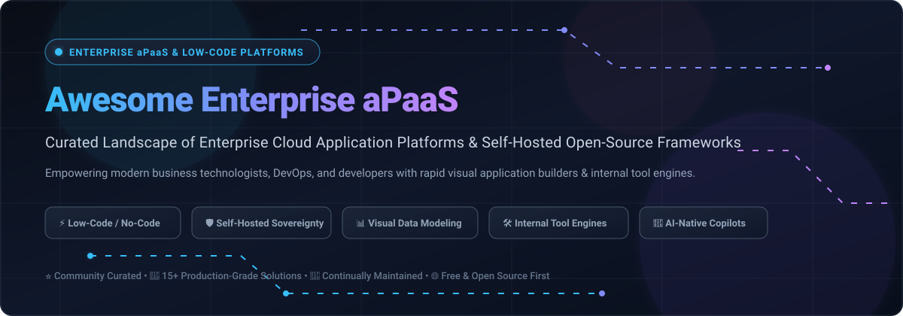

# 🚀 Awesome Enterprise Cloud Application Platform (aPaaS)

  

> ⚡ **A curated directory of top-tier Enterprise Cloud Application Platforms (aPaaS), Low-Code/No-Code (LCAP) suites, and self-hosted open-source application development frameworks.**

Whether you are architecting mission-critical enterprise workflows, building data-driven internal tools, generating CRUD operations from relational databases, or avoiding compounding per-user SaaS license fees, this guide provides an authoritative market index and feature breakdown.

---

## 📑 Table of Contents

- [📊 Sector Overview & Market Dynamics](#-sector-overview--market-dynamics)
- [🏢 SaaS & Hosted Enterprise aPaaS Platforms](#-saas--hosted-enterprise-apaas-platforms)
- [🛡️ Open-Source GitHub Projects](#️-open-source-github-projects)
  - [⭐ Open-Source Leaderboard (Sorted by Stars)](#-open-source-leaderboard-sorted-by-stars)
- [🤝 How to Contribute](#-how-to-contribute)
- [💖 Support & Community](#-support--community)
- [📈 Star History](#-star-history)
- [⚖️ Disclaimer](#️-disclaimer)

---

## 📊 Sector Overview & Market Dynamics

The global **Enterprise Cloud Application Platform (aPaaS)** and **Low-Code Application Platform (LCAP)** market was valued at **~$25 billion** in 2023 and is projected to expand to **$58 billion – $100+ billion by 2029–2030**, compounding at an annual growth rate (CAGR) of **14% to 22%**. 

The industry exhibits **moderate-to-high concentration** at the enterprise summit—anchored by hyperscalers and mega-cap SaaS titans (*Microsoft, Alphabet, Oracle, Salesforce, ServiceNow*) that leverage ecosystem lock-in, existing identity providers, and unified data layers. Simultaneously, the market supports a **dynamic, fast-growing fragmented tier** comprising pure-play commercial innovators (*Mendix, OutSystems, Appian*) and self-hosted **open-source frameworks** (*Appsmith, Budibase, ToolJet, NocoBase*). These open-source solutions empower engineering teams to achieve complete data sovereignty, eliminate per-seat pricing penalties, and deploy bespoke internal tooling directly behind enterprise firewalls.

---

## 🏢 SaaS & Hosted Enterprise aPaaS Platforms

*Commercial enterprise-grade cloud application platforms with visual modeling, governance, and fully managed multi-tenant hosting. Sorted descending by company enterprise scale / valuation.*

| Product | Company Valuation / Revenue | Pricing (Starting) | Free Tier / Trial Limits |
|:--------|:----------------------------|:-------------------|:-------------------------|
| **[Microsoft Power Platform](https://powerplatform.microsoft.com/)** | **~$3.9 Trillion** Market Cap (Microsoft) | **$20/user/month** (Power Apps Premium; unlimited apps); Legacy **$5/app/user** (Per App, 1 app) | **Free Forever (Developer Plan)**: 1 non-production developer environment, full Premium connector access, Dataverse database for personal learning/testing (no production use). |
| **[Google AppSheet](https://about.appsheet.com/)** | **~$3.5 Trillion** Market Cap (Alphabet) | **$5/user/month** (Starter tier); Core: $10/user/month | **Free Forever (Prototype Plan)**: Up to 10 test users with full feature access during prototype/development; zero time limit before production deployment. |
| **[Oracle APEX](https://apex.oracle.com/)** | **~$375 Billion** Market Cap (Oracle) | **$118/month** (~$0.0807/ECPU-hr, 2 ECPUs base OCI APEX service); **$0** (included with Oracle DB license) | **Free Forever (OCI Always Free APEX)**: 2 Autonomous DB instances, 20 GB Exadata storage, max 30 concurrent sessions (~3–6 active concurrent users); strictly reclaims if inactive >7 days. |
| **[Siemens Mendix](https://www.mendix.com/)** | **~$219 Billion** Market Cap (Siemens AG; acquired for $730M) | **$1,090/month** (Standard 1-App tier; unlimited apps from $2,725/month) | **Free Forever (Free Edition)**: Unlimited test users, full visual modeling, deployed on free Mendix Cloud; apps sleep after inactivity and limited to ~1–2 hour runtimes (non-production). |
| **[Salesforce Platform](https://www.salesforce.com/)** | **~$200 Billion** Market Cap (Salesforce) | **$25/user/month** (Platform Starter, 10 custom objects); Plus: $100/user/month | **Free Forever (Developer Edition)**: 1 full-feature developer org, 2 Salesforce Platform licenses, 5 MB data storage, 20 MB file storage for development/testing. |
| **[ServiceNow App Engine](https://www.servicenow.com/)** | **~$105 Billion** Market Cap (ServiceNow) | **~$75/user/month** (Standard/Foundation tier add-on, billed annually; 15 custom tables limit) | **Free Forever (Personal Developer Instance - PDI)**: 1 dedicated sandbox with App Engine Studio; hibernates after 10 days of inactivity, reclaimed if inactive >10 days when >90 days old; no commercial/outbound traffic. |
| **[Zoho Creator](https://www.zoho.com/creator/)** | **~$12.5 Billion** Valuation (Zoho Corp; ~$1.5B Revenue) | **$8/user/month** ($12/user/mo billed monthly; Standard tier, 1 app) | **Free Forever (Free Edition)**: 1 app, 1 user, 250 developer API calls/day, basic building (or 15-day full-feature trial for paid plans). |
| **[OutSystems](https://www.outsystems.com/)** | **$4.3 Billion** Valuation (KKR-backed Series G) | **~$36,300/year** (Entry-level OutSystems Developer Cloud base package, ~150 AOs, 100 internal users) | **Free Forever (Personal Edition)**: Up to 100 internal users, 1 GB database storage, max 8 concurrent active apps/workflows/agents; hosted on shared cloud without live production environment. |
| **[Appian](https://www.appian.com/)** | **$2.6 Billion** Market Cap (NASDAQ: APPN; ~$727M Revenue) | **~$70/user/month** (Standard tier, single data source, 5 RPA bots, typically 100-user contract minimum) | **Free Forever (Community Edition)**: 1 personal cloud environment, up to 15 users, 25k synced record rows, 1 RPA bot (~50 runs/day); live production disabled (or 14-day evaluation trial). |
| **[Quickbase (Pave)](https://www.quickbase.com/)** | **~$1.5 Billion+** Valuation (Vista Equity Partners; ~$215M+ ARR) | **$120/month** (Team tier, 120 credits/mo, 2 apps, 10 users); Department: $300/month | **Free Forever (Pave Free Plan)**: 1 app, 1 builder seat, up to 3 users, 100 credits/month (or 30-day trial of Enterprise platform). |

---

## 🛡️ Open-Source GitHub Projects

Open-source enterprise application platforms offer code transparency, Docker/Kubernetes native deployments, data sovereignty, and immunity from spiraling per-seat licensing.

### ⭐ Open-Source Leaderboard (Sorted by Stars)

| Project | Stars_Badge | Primary Focus & Architecture | Best For |
|:--------|:----------:|:-----------------------------|:---------|
| **[NocoDB](https://github.com/nocodb/nocodb)** |  | **Open-source Airtable alternative.** AGPL-3.0. Connects to PostgreSQL, MySQL, SQL Server, and SQLite, transforming existing schema into smart spreadsheets with REST/GraphQL APIs, webhooks, and collaborative views (Grid, Kanban, Gallery, Form). | Teams seeking no-code database views and business application spreadsheets directly over relational databases. |
| **[Appsmith](https://github.com/appsmithorg/appsmith)** |  | **Enterprise-grade low-code platform for internal tools.** Apache-2.0. Drag-and-drop builder with 45+ UI widgets, native JS execution, RBAC, SSO, audit logs, and connectors for 25+ databases and REST/GraphQL APIs. | Engineering teams building complex internal CRUD dashboards and customer support panels with enterprise governance. |
| **[ToolJet](https://github.com/ToolJet/ToolJet)** |  | **AI-native open-source low-code application builder.** AGPL-3.0. Visual canvas with 50+ built-in widgets, ToolJet AI copilot for natural language app generation, JS/Python code execution, and 50+ database/API plugins. | Teams wanting AI-assisted application scaffolding with self-hosted Docker/K8s deployments. |
| **[Refine](https://github.com/refinedev/refine)** |  | **Code-first React framework for internal tools and admin panels.** MIT. Headless design decoupled from UI libraries (Ant Design, MUI, Mantine, Tailwind CSS) with native routing, auth providers, and automated state management. | Developers demanding complete source code ownership and total UI customizability without the constraints of visual drag-and-drop builders. |
| **[Budibase](https://github.com/Budibase/budibase)** |  | **All-in-one low-code CRUD application platform.** GPL-3.0. Auto-generates CRUD screens from existing SQL tables, provides an internal database (BudibaseDB), robust workflow automation engine, and public/private portals. | Operations and IT specialists needing rapid transformation of raw database tables into functional business applications. |
| **[NocoBase](https://github.com/nocobase/nocobase)** |  | **Data-model-driven no-code application framework.** AGPL-3.0. 100% plugin-driven architecture where everything is an extensible module. Define relational schemas, business logic, workflows, and UI blocks collaboratively. | Architects requiring deep custom business data models, granular role permissions, and full plugin extensibility. |
| **[Teable](https://github.com/teableio/teable)** |  | **Real-time, hyper-fast no-code database built on Postgres.** AGPL-3.0. Combines Airtable-grade UI fluidity with true PostgreSQL performance, handling millions of records with sub-millisecond responsiveness. | High-volume operational teams requiring scalable spreadsheet-database ergonomics without hitting Airtable row ceilings. |
| **[Amplication](https://github.com/amplication/amplication)** |  | **Developer backend and service generator.** Apache-2.0. Visually design entities, relations, and RBAC to generate clean, human-readable Node.js / NestJS and Prisma backend code with automated Git PRs. | Backend developers wanting boilerplate-free, enterprise-ready microservices and REST/GraphQL APIs with Git sync. |
| **[ILLA Cloud](https://github.com/illacloud/illa-builder)** |  | **AI-augmented low-code internal tool builder.** Apache-2.0. Visual canvas with pre-built components, multi-data-source queries, and deep integration with Hugging Face and LLM agents for smart workflows. | Developers looking to assemble AI-enabled workflow utilities and administrative dashboards with rapid visual wiring. |
| **[Rowy](https://github.com/rowyio/rowy)** |  | **Low-code backend platform for Firebase and Google Cloud.** Apache-2.0. Airtable-like spreadsheet GUI over Firestore database with Node.js Cloud Functions written directly in the browser. | Teams building mobile and web backends on Firebase needing an intuitive CMS and automated serverless workflows. |
| **[OpenBlocks](https://github.com/openblocks-dev/openblocks)** |  | **Extensible open-source IDE for internal tools.** AGPL-3.0. Lightweight visual builder with 50+ widgets, SQL and REST connectors, custom component SDK, and granular permission access. | Engineering teams looking for a clean, modular self-hosted alternative to Retool for developer-friendly app scaffolding. |
| **[Lowdefy](https://github.com/lowdefy/lowdefy)** |  | **Configuration-driven web framework for internal applications.** Apache-2.0. Build internal tools, dashboards, and workflows by declaring YAML/JSON schemas that compile into performant Next.js apps. | DevOps and Platform teams wanting version-controlled, git-reviewable Infrastructure-as-Code for enterprise business tools. |

---

## 🤝 How to Contribute

Contributions are warmly welcomed! Help keep this enterprise directory accurate, comprehensive, and up-to-date:

1. 🍴 **Fork** this repository.
2. 🌿 Create a feature branch: `git checkout -b feature/add-platform-name`.
3. ✍️ Add or update platforms in `README.md` following the established table structure (link, exact pricing, verified free tier limits, and stargazer badge).
4. 📝 Ensure facts are objective, verifiable, and neutral.
5. 🚀 Submit a pull request with a concise summary of changes!

---

## 💖 Support & Community

If this repository helps you navigate the enterprise aPaaS landscape or choose the right application platform for your team:

- ⭐ **Star this repository** to bookmark it and help others discover it!
- 🍴 **Fork the repo** to contribute your own insights and extensions.
- 📢 **Share with your network** on LinkedIn, X/Twitter, or Reddit.
- ☕ **Support the maintainer**: You can sponsor ongoing maintenance and open-source research through the [GitHub Sponsors Dashboard](https://github.com/sponsors/ishandutta2007).

---

## 📈 Star History

---

## ⚖️ Disclaimer

- This repository is an independent, community-driven informational resource. Trademarks and product names belong to their respective corporate owners.
- **Enterprise Cost Architecture**: Be aware that commercial aPaaS licensing frequently scales with compounded per-user fees, application object thresholds (AOs), and data transaction volume. Always benchmark internal total cost of ownership (TCO) between enterprise cloud subscriptions and self-hosted open-source clusters prior to enterprise rollout.

---

  Built with ❤️ for platform architects, developers, and technology leaders.

